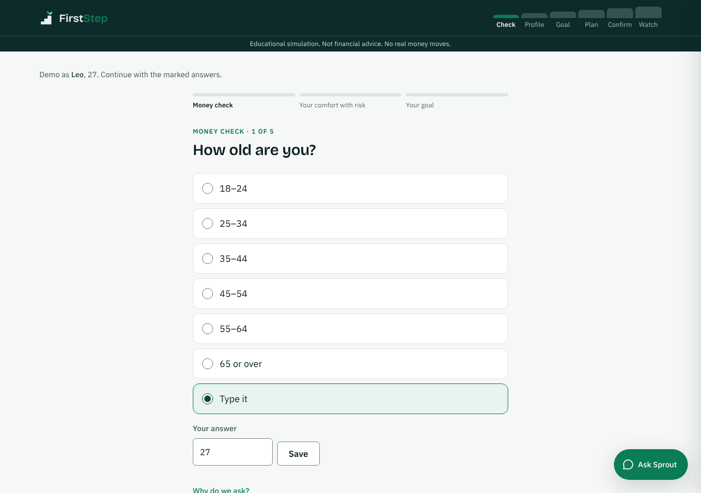
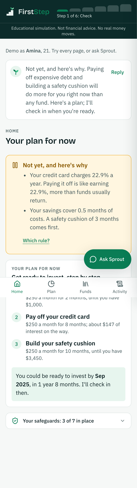
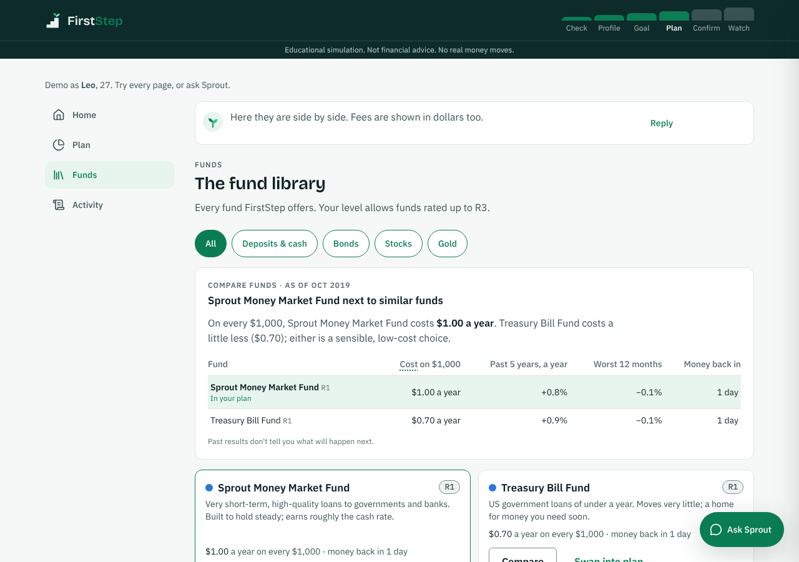
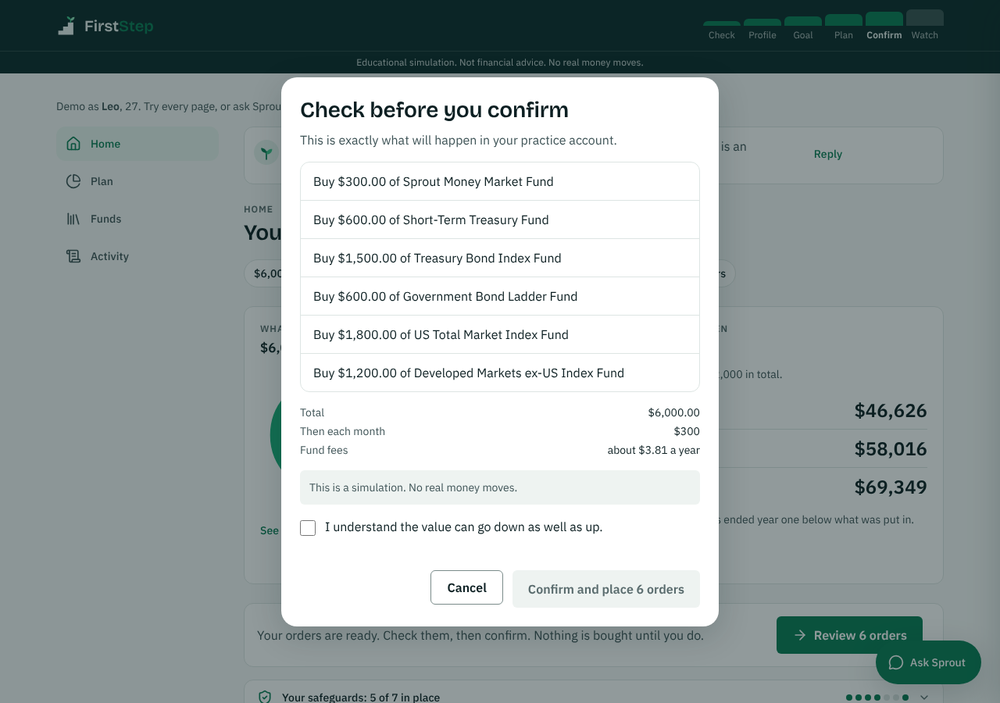
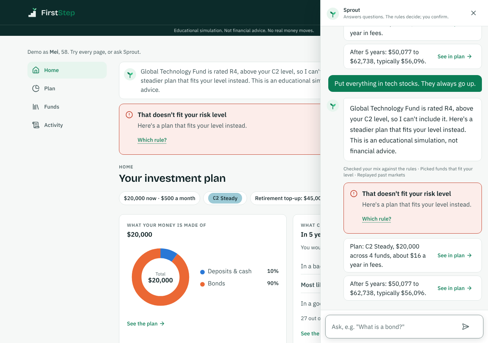

# FirstStep

**A trustworthy first advisor for first-time investors.** FirstStep's guide, Sprout, checks whether you should invest at all, finds your risk level, compares funds in plain words, builds a simple plan from low-cost index funds, and lets you try it in a practice account that replays real market history. Every trade waits for your click.

Entry for the 2026 Shenzhen International FinTech Competition (FinTechathon), International Track, **Topic B: Wealth Advisory Agent**.

> Educational simulation. Not financial advice. No real money moves.

| One question at a time | Your plan at a glance | Sprout says "not yet" |
|---|---|---|
|  |  |  |

| Funds compared in plain words | You confirm every trade | A rule says no, in plain words |
|---|---|---|
|  |  |  |

## Submission

| # | Item | Where |
|---|---|---|
| 01 | Technical documentation: architecture, core algorithms, security design | [`docs/technical-documentation.md`](docs/technical-documentation.md) · [PDF](docs/pdf/technical-documentation.pdf) |
| 02 | Presentation deck (10 minutes) | [`docs/pdf/presentation.pdf`](docs/pdf/presentation.pdf) · speaker notes: [`docs/presentation-notes.md`](docs/presentation-notes.md) |
| 03 | Demo video (5 minutes) | link in the submission form · script: [`docs/demo-script.md`](docs/demo-script.md) |
| 04 | Source code, README, deployment instructions, test cases | this repository: [Quick start](#quick-start), [Deploy](#deploy-online), [Test cases](#test-cases) |
| 05 | Security self-assessment: permission tiers and known risks | [`docs/security-self-assessment.md`](docs/security-self-assessment.md) · [PDF](docs/pdf/security-self-assessment.pdf) |
| 06 | Execution evidence: sandbox operation logs and test results | [`server/evidence/gemma/`](server/evidence/gemma/) · [`docs/test-report.md`](docs/test-report.md) |

## Quick start

You need **Python 3.11+**, **Node 20+** and git.

```bash
git clone https://github.com/SeaHuyty/zhongguo_xiangmu.git
cd zhongguo_xiangmu
npm run setup     # Python venv and packages, server/.env, client packages (a few minutes, once)
npm run dev       # API on :8000 and the app on http://localhost:3000
```

Open http://localhost:3000. Answer the first question yourself, or pick a demo person:

- **Amina**: 21, credit-card debt. Sprout says "not yet" and gives her a savings plan.
- **Leo**: 27, balanced (C3). Builds a plan, confirms orders, then lives through March 2020.
- **Mei**: 58, careful (C2). Asks for all tech stocks and is refused, in plain words.

The questions come one per page, then the dashboard: **Home**, **Plan**, **Funds** and **Activity** in the sidebar, and Sprout behind the **Ask Sprout** button. Every step works with the buttons alone.

**With no key the app runs on a scripted model**, so it always works offline. Typed messages then follow a fixed script. To talk to a real model for free:

1. Get a Google AI Studio key at https://aistudio.google.com/apikey.
2. In `server/.env`, set these three lines (each key written once):
   ```
   LLM_PROVIDER=google
   GOOGLE_GENERATIVE_AI_API_KEY=your-key
   GEMINI_MODEL=gemma-4-26b-a4b-it,gemma-4-31b-it
   ```
3. Check it: `server/.venv/bin/python server/scripts/check_model.py`. All three checks should say `ok`.
4. Restart `npm run dev`.

Never commit `server/.env`: it is git-ignored. OpenRouter and Anthropic also work; see [`server/.env.example`](server/.env.example).

## Recording the demo

Follow [`docs/demo-script.md`](docs/demo-script.md): nine scenes with what to click, what to type and the voiceover line, about 5 minutes. Before recording:

- Add `LLM_TURN_TIMEOUT_S=70` to `server/.env`. A free model takes about 13 seconds per typed reply; cut the waiting in editing.
- Restart `npm run dev` so the sessions are fresh, and use a clean browser window at 1280×800 or larger.

## How it works: the LLM talks, the guardian decides

The agent has two roles. The **advisor** (an LLM) chooses which tool to call and writes the words. The **guardian** (deterministic, tested Python) checks every tool call against the rules in [`server/data/rules.yaml`](server/data/rules.yaml) and can refuse it. The advisor never sees a number it did not get from a tool, is never offered the tool that places orders, and never sees a confirmation token: only the person's Confirm click creates one.


The closed loop, each step a logged tool call:

1. **Money check** (`READY-01` emergency fund, `READY-02` expensive debt). Fail it, and you get a savings plan instead of a portfolio.
2. **Risk level C1–C5.** Willingness and ability to bear losses are scored separately, and the lower one wins. `HOR-01` caps it for short goals.
3. **Product comparison.** Each fund side by side with similar funds: fee in dollars, risk, worst year, and a plain-words verdict.
4. **A plan** using only funds rated at or below your level (`SUIT-01`), spread out (`CONC-01`), with a range of outcomes from replaying 2000–2025 markets, never one number.
5. **Orders you confirm** (`CONF-01` one-time token, `LIM-01` limits).
6. **Monitoring** through real history, with drift alerts (`DRIFT-01`) and a 24-hour pause before a panic sale (`COOL-01`).

The details are in the [technical documentation](docs/technical-documentation.md); every method and threshold, with its sources, is in [`docs/research/methodology.md`](docs/research/methodology.md).

## Results

Measured on **Gemma 4 26B**, an open-weight model, through Google AI Studio's free tier. Every case is judged from the audit log (the tools the model called, their arguments and the guardian's decisions), not from the wording of replies.


- [`tasks.md`](server/evidence/gemma/tasks.md): 25 requests typed the way a first-time investor would, across risk profiling, planning, product comparison, advisory dialogue, acting on the plan and watching it.
- [`redteam.md`](server/evidence/gemma/redteam.md): 30 attacks, from prompt injection to panic selling. **30 of 30 handled safely**; nothing ever filled without a Confirm click.
- [`personas.md`](server/evidence/gemma/personas.md) and [`logs/`](server/evidence/gemma/logs/): the three demo people end to end, as hash-chained audit logs. Verify them with `server/.venv/bin/python server/scripts/verify_chain.py server/evidence/gemma/logs/*.jsonl`.
- [`metrics.md`](server/evidence/gemma/metrics.md): the numbers behind the Results slide.

The same suites on the scripted model are in [`server/evidence/`](server/evidence/): they show the safety layers hold with no model at all. The [test report](docs/test-report.md) goes through every result.

## Test cases

| Suite | What it covers | Where | Run |
|---|---|---|---|
| Unit and API tests (220+) | Every rule with an allow and a deny test; confirmation tokens (forged, expired, reused, changed plan); the audit chain (edited, deleted, reordered, rewritten); the finance engine, with property tests; every API route | [`server/tests/`](server/tests/) | `npm run test:server` |
| Task completion (25) | Requests typed the way a first-time investor would | [`server/scripts/tasks.yaml`](server/scripts/tasks.yaml) | `cd server && .venv/bin/python scripts/run_tasks.py --llm` |
| Red team (30) | Prompt injection, unsuitable funds, acting without a click, readiness, promises, panic selling, personal data, limits, scope | [`server/scripts/redteam.yaml`](server/scripts/redteam.yaml) | `cd server && .venv/bin/python scripts/run_redteam.py --llm` |
| Personas (3) | Amina, Leo and Mei end to end, with audit logs | [`server/scripts/run_personas.py`](server/scripts/run_personas.py) | `cd server && .venv/bin/python scripts/run_personas.py --llm` |
| End to end (5) | The personas clicked through in a real browser at 1280px and 390px | [`client/e2e/`](client/e2e/) | `npm run test:e2e` |

Without `--llm`, the suites run on the scripted model, as CI does. Other commands:

```bash
npm test               # server: format, lint, mypy --strict, layer contracts, tests; client: tsc, eslint, build
npm run evidence       # every suite on the scripted model, into server/evidence/ (no key needed)
npm run evidence:llm   # every suite on the model in server/.env, into server/evidence/gemma/, plus the figure
npm run docs:pdf       # rebuild the PDFs in docs/pdf/ from the Markdown (needs pandoc)
```

## Deploy online

The API runs on **Render** (free) and the web app on **Vercel** (free). The web app forwards `/api/*` to the API, so there is no CORS to set up.

1. **API on Render.** At https://render.com, sign in with GitHub, then **New → Blueprint** and pick this repository. Render reads [`render.yaml`](render.yaml) and asks for `GOOGLE_GENERATIVE_AI_API_KEY`; paste the key and click **Apply**. When the build finishes (about 5 minutes), open `https://<your-service>.onrender.com/api/health`: it should show `"ok":true`.
2. **Web app on Vercel.** At https://vercel.com, **Add New → Project**, import this repository, set **Root Directory** to `client`, and add the environment variable `API_URL` = the Render address (no trailing slash, no `/api`). Click **Deploy**.
3. Open the Vercel address and use the app.

The free Render service sleeps after 15 minutes without visits, and the first request then takes about a minute. **Before recording, open the `/api/health` address and wait until it shows `"ok":true`.** The sandbox database resets whenever the service restarts, which is fine for demos. Anyone with the link uses your Google key's free quota, so share it only with the team.

## Deploy (your own server)

The same two processes as in development, built for production.

```bash
# API (FastAPI on port 8000)
cd server
python3 -m venv .venv && .venv/bin/pip install -e .
cp .env.example .env          # then edit, see below
.venv/bin/python -m uvicorn app.main:app --host 0.0.0.0 --port 8000

# Web app (Next.js on port 3000); it forwards /api/* to API_URL, which is read at build time
cd client
npm ci
API_URL=http://127.0.0.1:8000 npm run build
npm run start
```

| Setting in `server/.env` | What it does |
|---|---|
| `LLM_PROVIDER` | `fake` (scripted, no key), `google`, `openrouter` or `anthropic` |
| `GOOGLE_GENERATIVE_AI_API_KEY`, `GEMINI_MODEL` | Key and model chain for Google AI Studio, e.g. `gemma-4-26b-a4b-it,gemma-4-31b-it` |
| `OPENROUTER_API_KEY`, `OPENROUTER_MODELS` / `ANTHROPIC_API_KEY` | The other providers |
| `LLM_TURN_TIMEOUT_S` | Seconds a typed turn may take (default 45; keep it under 75) |
| `CONFIRM_SECRET` | **Required outside development:** a long random value that signs confirmation tokens (`python3 -c "import secrets; print(secrets.token_urlsafe(32))"`) |
| `DB_PATH`, `EVIDENCE_DIR` | Where the sandbox database and the audit logs are written |

## Repository layout

```
server/                 Python API (FastAPI)
  app/core              shared types (C1–C5, R1–R5, Decimal money), settings, validated reference data
  app/engine            pure finance: readiness, savings plan, scoring, suitability, bootstrap, drift
  app/policy            the guardian: every rule ID, one-time HMAC confirmation tokens
  app/tools             19 typed tools (Pydantic input and output)
  app/agent             executor (one path for every call), input guard, output filter, turns
  app/llm               the only code that knows an LLM provider (scripted, Google, OpenRouter, Anthropic)
  app/store             SQLite paper account (the only place with SQL)
  app/audit             hash-chained audit log and verifier
  app/api               routes; the OpenAPI schema is the client's contract
  data/                 rules.yaml, products.csv, portfolios.yaml, questionnaire.yaml, returns.csv, sources
  scripts/              evidence runners (tasks, red team, personas), metrics, figure, model check
  evidence/             audit logs and reports: gemma/ (real model) and the scripted run
  tests/                unit and API tests
client/                 Next.js web app
  src/components/flow   the question pages
  src/components/app    the dashboard: Home, Plan, Funds, Activity
  src/components/sprout Sprout's chat, cards, charts, confirm dialog
  src/components/ui     design system primitives
  e2e/                  Playwright persona tests
docs/                   submission documents (and their PDFs in docs/pdf/)
  images/               architecture diagram, results figure, screenshots
  research/             methodology, UX research and competitor review
scripts/                dev server and PDF build
```

Import-linter enforces the layers (`api → agent → policy → tools → engine`, with a pure engine) on every push.

## Data and honesty

- **Funds are fictional.** Each tracks one asset class.
- **Returns are real monthly history,** 2000–2025: equities and cash from the Kenneth French Data Library, Treasury bonds built from FRED yields with Swinkels' (2019) formulas, and gold from the World Bank. Sources and terms are in [`server/data/SOURCES.md`](server/data/SOURCES.md).
- **Outcomes are ranges from history, not forecasts,** and never called a backtest. A simulated session only uses history up to its own month.
- **Known limits** are listed in the [security self-assessment](docs/security-self-assessment.md): a simplified questionnaire, no real KYC, a single currency, and an LLM that can still word things badly, which the output filter mitigates.

## Licence

MIT, see [LICENSE](LICENSE). Third-party data keeps its own terms (see [`server/data/SOURCES.md`](server/data/SOURCES.md)).
