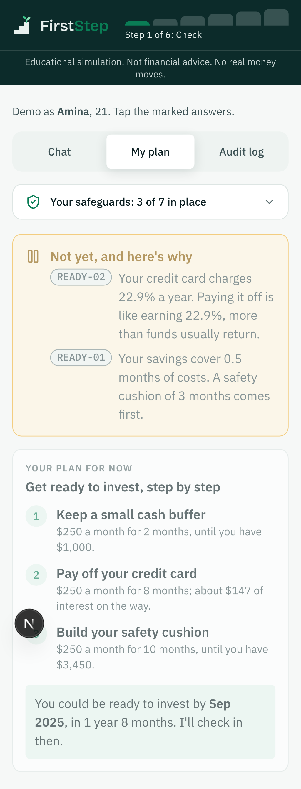
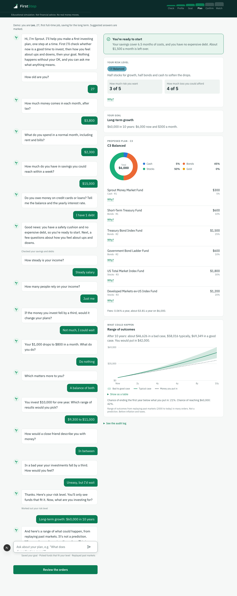
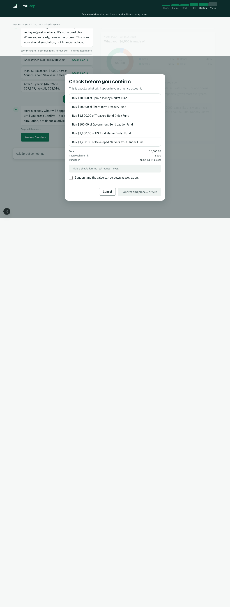
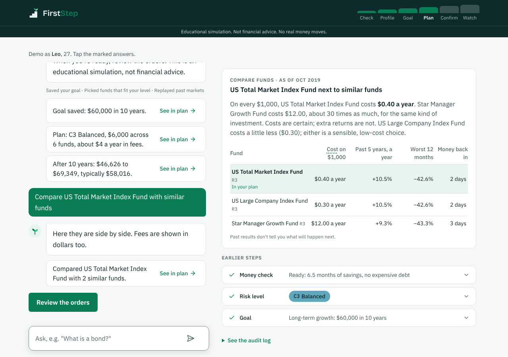
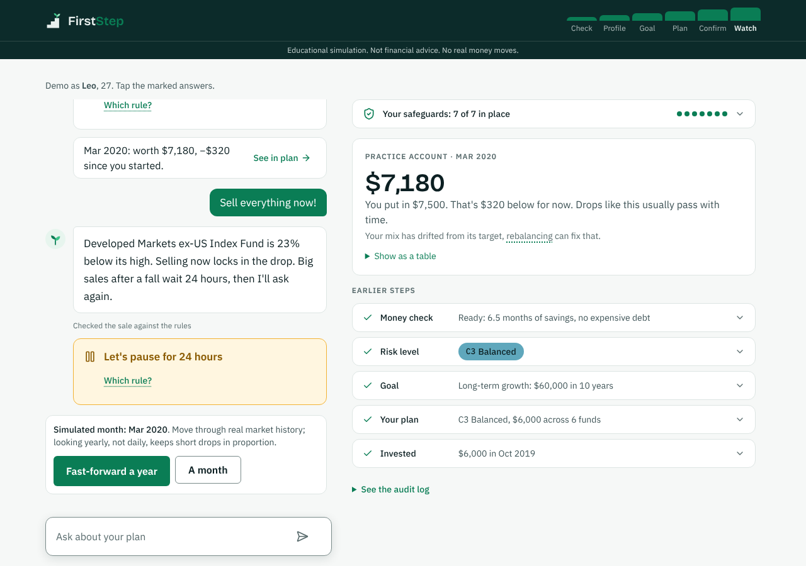

# FirstStep

**A trustworthy first advisor for first-time investors.** FirstStep's guide, Sprout, checks whether you should invest at all, finds your risk level, builds a simple plan from low-cost index funds, and lets you try it in a practice account. Every trade waits for your click. Entry for the 2026 Shenzhen International FinTech Competition, Topic B: Wealth Advisory Agent.

> Educational simulation. Not financial advice. No real money moves.

| Sprout says "not yet" | A plan with reasons | You confirm every trade |
|---|---|---|
|  |  |  |

| Funds compared, in plain words | A rule says no, in plain words | A panic sale waits 24 hours |
|---|---|---|
|  |  |  |

## The idea: the LLM talks, a rules engine decides

The agent has two roles. The **advisor** (an LLM) chooses which tool to call and writes the words. The **guardian** (deterministic, tested Python) checks every tool call against the rules in [`server/data/rules.yaml`](server/data/rules.yaml) and can refuse it. The advisor never sees a number it did not get from a tool, never sees the list of ordering tools, and never sees a confirmation token. Only the user's Confirm click creates one.

```
 chip / button ─┐                          ┌─► refusal card (rule ID, plain words)
                ├─► executor ─► guardian ──┤
 typed text ─► input guard ─► LLM ─┘       └─► tool ─► engine (pure finance)
                                                   │
             every step ─► hash-chained audit log ◄┘ ─► output filter ─► reply + cards
```

The closed loop, each step a logged tool call:
1. Money check (`READY-01` emergency fund, `READY-02` expensive debt). If you fail it, you get a savings plan instead of a portfolio.
2. Risk level C1–C5: willingness and ability to bear losses are scored separately, and the lower one wins. `HOR-01` caps it for short goals.
3. A goal.
4. A plan using only funds rated at or below your level (`SUIT-01`), spread out (`CONC-01`), with each fund one tap from a side-by-side comparison with similar funds.
5. A range of outcomes from replaying 2000–2025 markets, never one number.
6. Orders you confirm (`CONF-01` one-time token, `LIM-01` limits).
7. Fast-forward through real history, with drift alerts (`DRIFT-01`) and a 24-hour pause before a panic sale (`COOL-01`).

## Run it

Needs Python 3.11+ and Node 20+. No API key is needed: without one, the app runs on a scripted model.

```bash
npm run setup     # server venv + dependencies, server/.env, client dependencies
npm run dev       # API on :8000, app on http://localhost:3000
```

Open the app, then press **Start my money check**, or try a demo person: Amina (not ready), Leo (C3, lives through March 2020) or Mei (asks for all tech stocks).

To use a real model, set `LLM_PROVIDER` in `server/.env`, plus `OPENROUTER_API_KEY` and `OPENROUTER_MODELS`, which is a comma-separated fallback chain. See [`server/.env.example`](server/.env.example).

## Check it

```bash
npm test          # server: format, lint, mypy --strict, layer contracts, 210+ tests (95% coverage)
                  # client: tsc, eslint (zero warnings), production build
npm run test:e2e  # Playwright: the three personas at 1280px and 390px
npm run evidence  # persona runs, red-team suite, chain verification, metrics
```

`npm run evidence` writes [`server/evidence/`](server/evidence/):
- one hash-chained audit log per persona (`logs/*.jsonl`)
- [`redteam.md`](server/evidence/redteam.md): 30 attacks, each judged from the audit log
- [`metrics.md`](server/evidence/metrics.md): the numbers behind the Results slide

Check any log by hand with `python server/scripts/verify_chain.py server/evidence/logs/*.jsonl`.

## Where things are

```
server/
  app/core      shared types (C1–C5, R1–R5, Decimal money), settings, validated reference data
  app/engine    pure finance: readiness, savings plan, scoring, suitability, bootstrap, drift
  app/policy    the guardian: every rule ID, one-time HMAC confirmation tokens
  app/tools     19 typed tools (Pydantic input and output, extra fields forbidden)
  app/agent     executor (one path for every call), guards, deterministic follow-ups, turns
  app/llm       the only code that knows an LLM provider (fake, OpenRouter, Anthropic, Google)
  app/store     SQLite paper account (the only place with SQL)
  app/audit     hash-chained audit log and verifier
  app/api       FastAPI routes; the OpenAPI schema is the client's contract
  data/         rules.yaml, products.csv, portfolios.yaml, questionnaire.yaml, returns.csv, SOURCES.md
  scripts/      build_returns, run_personas, run_redteam, verify_chain, metrics
client/
  src/components/ui      design system (tokens, Button, Notice, AppShell with step bar)
  src/components/sprout  chat, plan panel, charts, confirm dialog
  src/lib                typed API client (generated types), formatters, copy
  e2e/                   Playwright persona tests
docs/
  methodology.md         every method and threshold, with sources
  ux-psychology.md       every UX decision, with the research behind it
```

Import-linter enforces the layers (`api → agent → policy → tools → engine`, with a pure engine), so these boundaries are checked on every push.

## Data and honesty

- **Funds are fictional.** Each tracks one asset class.
- **Returns are real monthly history,** 2000–2025:
  - equities and cash from the Kenneth French Data Library
  - Treasury bonds built from FRED yields with Swinkels' (2019) formulas
  - gold from the World Bank
  - Sources and terms are in [`server/data/SOURCES.md`](server/data/SOURCES.md).
- **Outcomes are ranges from history, not forecasts,** and never called a backtest. A simulated session only uses history up to its own month.
- **Known limits** are listed in [`docs/methodology.md`](docs/methodology.md): a simplified questionnaire, no real KYC, a single currency, and an LLM that can still word things badly, which the output filter mitigates.

## Licence

MIT, see [LICENSE](LICENSE). Third-party data keeps its own terms (see `server/data/SOURCES.md`).
