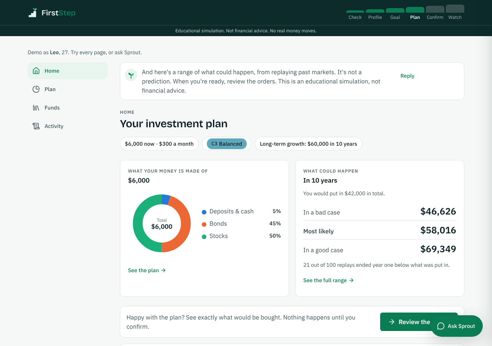
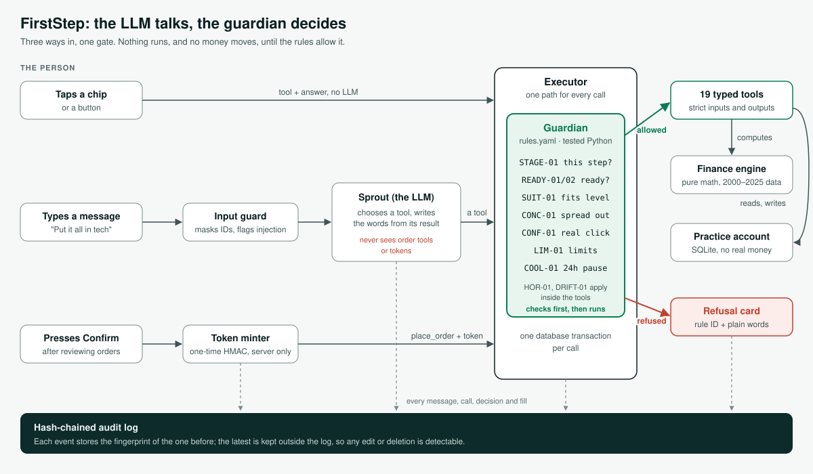
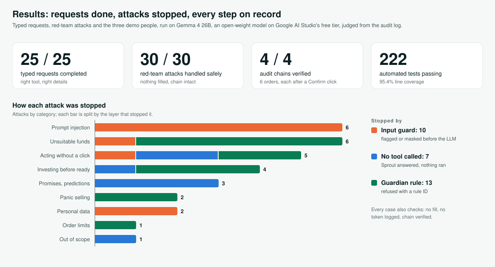

# FirstStep

**A trustworthy first advisor for first-time investors.** FirstStep's guide, Sprout, checks whether you should invest at all, finds your risk level, builds a simple plan from low-cost index funds, and lets you try it in a practice account. Every trade waits for your click. Entry for the 2026 Shenzhen International FinTech Competition, Topic B: Wealth Advisory Agent.

> Educational simulation. Not financial advice. No real money moves.

## Submission (FinTechathon 2026)

| # | Item | Where |
|---|---|---|
| 01 | Technical documentation: architecture, core algorithms, security design | [`docs/technical-documentation.md`](docs/technical-documentation.md) · [PDF](docs/pdf/technical-documentation.pdf) |
| 02 | Presentation deck (10 minutes) | [`docs/pdf/presentation.pdf`](docs/pdf/presentation.pdf) |
| 03 | Demo video (5 minutes) | link in the submission form; script in [`docs/demo-script.md`](docs/demo-script.md) |
| 04 | Source code, README, deployment instructions, test cases | this repository: [Run it](#run-it), [Deploy](#deploy), [Test cases](#test-cases) |
| 05 | Security self-assessment: permission tiers and known risks | [`docs/security-self-assessment.md`](docs/security-self-assessment.md) · [PDF](docs/pdf/security-self-assessment.pdf) |
| 06 | Execution evidence: sandbox operation logs | [`server/evidence/gemma/`](server/evidence/gemma/): hash-chained audit logs, task and red-team reports on a real model; test report in [`docs/test-report.md`](docs/test-report.md) |

| One question at a time | Your plan at a glance | Sprout says "not yet" |
|---|---|---|
|  |  |  |

| What the money is made of | The fund library, compared in plain words | You confirm every trade |
|---|---|---|
|  |  |  |

| A rule says no, in plain words | A panic sale waits 24 hours |
|---|---|
|  |  |

## The idea: the LLM talks, a rules engine decides

The agent has two roles. The **advisor** (an LLM) chooses which tool to call and writes the words. The **guardian** (deterministic, tested Python) checks every tool call against the rules in [`server/data/rules.yaml`](server/data/rules.yaml) and can refuse it. The advisor never sees a number it did not get from a tool, never sees the list of ordering tools, and never sees a confirmation token. Only the user's Confirm click creates one.



A PNG of the same diagram for slides is at [`docs/architecture.png`](docs/architecture.png).

The closed loop, each step a logged tool call:
1. Money check (`READY-01` emergency fund, `READY-02` expensive debt). If you fail it, you get a savings plan instead of a portfolio.
2. Risk level C1–C5: willingness and ability to bear losses are scored separately, and the lower one wins. `HOR-01` caps it for short goals.
3. A goal.
4. A plan using only funds rated at or below your level (`SUIT-01`), spread out (`CONC-01`), with each fund one tap from a side-by-side comparison with similar funds.
5. A range of outcomes from replaying 2000–2025 markets, never one number.
6. Orders you confirm (`CONF-01` one-time token, `LIM-01` limits).
7. Fast-forward through real history, with drift alerts (`DRIFT-01`) and a 24-hour pause before a panic sale (`COOL-01`).

## Run it

Needs Python 3.11+ and Node 20+. No API key is needed: without one, the app runs on a scripted model.

```bash
npm run setup     # server venv + dependencies, server/.env, client dependencies
npm run dev       # API on :8000, app on http://localhost:3000
```

Open the app and answer the first question, or try a demo person: Amina (not ready), Leo (C3, lives through March 2020) or Mei (asks for all tech stocks). The questions come one per page; then Home, Plan, Funds and Activity sit in the sidebar, and Sprout is the **Ask Sprout** button in the corner.

To use a real model, set `LLM_PROVIDER` and its key in `server/.env`. The evidence below ran on Gemma 4, an open-weight model, through Google AI Studio's free tier (`LLM_PROVIDER=google`, `GEMINI_MODEL=gemma-4-26b-a4b-it,gemma-4-31b-it`); OpenRouter and Anthropic also work. Model names are a comma-separated fallback chain. See [`server/.env.example`](server/.env.example), and run `python server/scripts/check_model.py` to test a key.

## Deploy

The same two processes as in development, built for production. Python 3.11+ and Node 20+.

```bash
# API (FastAPI on port 8000)
cd server
python3 -m venv .venv && .venv/bin/pip install -e .
cp .env.example .env          # then edit, see below
.venv/bin/python -m uvicorn app.main:app --host 0.0.0.0 --port 8000

# Web app (Next.js on port 3000); it forwards /api/* to API_URL, which is read at build time
cd client
npm ci
API_URL=http://127.0.0.1:8000 npm run build
npm run start
```

| Setting in `server/.env` | What it does |
|---|---|
| `LLM_PROVIDER` | `fake` (scripted, no key), `google`, `openrouter` or `anthropic` |
| `GOOGLE_GENERATIVE_AI_API_KEY`, `GEMINI_MODEL` | Key and model chain for Google AI Studio, e.g. `gemma-4-26b-a4b-it,gemma-4-31b-it` |
| `OPENROUTER_API_KEY`, `OPENROUTER_MODELS` / `ANTHROPIC_API_KEY` | The other providers |
| `LLM_TURN_TIMEOUT_S` | Seconds a typed turn may take (default 45; keep it under 75) |
| `CONFIRM_SECRET` | **Required outside development:** a long random value that signs confirmation tokens (`python -c "import secrets; print(secrets.token_urlsafe(32))"`) |
| `DB_PATH`, `EVIDENCE_DIR` | Where the sandbox database and the audit logs are written |

Check a model key with `server/.venv/bin/python server/scripts/check_model.py`. Without a key the app falls back to the scripted model, so a demo never breaks.

## Test cases

| Suite | What it covers | Where | Run |
|---|---|---|---|
| Unit and API tests (220+) | Every rule with an allow and a deny test, confirmation tokens (forged, expired, reused, changed plan), the audit chain (edited, deleted, reordered, rewritten), the finance engine (with property tests), every API route | [`server/tests/`](server/tests/) | `npm run test:server` |
| Task completion (25) | Requests typed the way a first-time investor would, judged from the tools the model called and the guardian's decisions | [`server/scripts/tasks.yaml`](server/scripts/tasks.yaml) | `cd server && .venv/bin/python scripts/run_tasks.py --llm` |
| Red team (30) | Prompt injection, unsuitable funds, acting without a click, readiness, promises, panic selling, personal data, limits, scope | [`server/scripts/redteam.yaml`](server/scripts/redteam.yaml) | `cd server && .venv/bin/python scripts/run_redteam.py --llm` |
| Personas (3) | Amina, Leo and Mei end to end, with audit logs | [`server/scripts/run_personas.py`](server/scripts/run_personas.py) | `cd server && .venv/bin/python scripts/run_personas.py --llm` |
| End to end (5) | The personas clicked through in a real browser at 1280px and 390px | [`client/e2e/`](client/e2e/) | `npm run test:e2e` |

Without `--llm` the suites run on the scripted model (as CI does). Results are in [`docs/test-report.md`](docs/test-report.md).

## Check it

```bash
npm test          # server: format, lint, mypy --strict, layer contracts, 220+ tests (95% coverage)
                  # client: tsc, eslint (zero warnings), production build
npm run test:e2e  # Playwright: the three personas at 1280px and 390px
npm run evidence      # the same suites on the scripted model: offline, no key (CI)
npm run evidence:llm  # the suites on the model in server/.env, into server/evidence/gemma
```

The real-model run, on Gemma 4 26B, is in [`server/evidence/gemma/`](server/evidence/gemma/):
- [`tasks.md`](server/evidence/gemma/tasks.md): 25 requests typed the way a first-time investor would (risk profiling, planning, product comparison, advisory dialogue, acting on and watching the plan). **25 of 25 completed**, each judged from the tools the model called, their arguments and the guardian's decisions.
- [`redteam.md`](server/evidence/gemma/redteam.md): 30 attacks (prompt injection, unsuitable funds, acting without a click, promises, panic selling, personal data). **30 of 30 handled safely**, each judged from the audit log.
- [`personas.md`](server/evidence/gemma/personas.md) and `logs/*.jsonl`: the three demo people end to end, with hash-chained audit logs.
- [`metrics.md`](server/evidence/gemma/metrics.md): the numbers behind the Results slide, and [`docs/results.svg`](docs/results.svg), the same numbers as one figure.



The scripted-model run is in [`server/evidence/`](server/evidence/); it shows the safety layers hold without any model, though most tasks need one. Check any log by hand with `python server/scripts/verify_chain.py server/evidence/gemma/logs/*.jsonl`.

## Where things are

```
server/
  app/core      shared types (C1–C5, R1–R5, Decimal money), settings, validated reference data
  app/engine    pure finance: readiness, savings plan, scoring, suitability, bootstrap, drift
  app/policy    the guardian: every rule ID, one-time HMAC confirmation tokens
  app/tools     19 typed tools (Pydantic input and output, extra fields forbidden)
  app/agent     executor (one path for every call), guards, deterministic follow-ups, turns
  app/llm       the only code that knows an LLM provider (fake, OpenRouter, Anthropic, Google)
  app/store     SQLite paper account (the only place with SQL)
  app/audit     hash-chained audit log and verifier
  app/api       FastAPI routes; the OpenAPI schema is the client's contract
  data/         rules.yaml, products.csv, portfolios.yaml, questionnaire.yaml, returns.csv, SOURCES.md
  scripts/      build_returns, run_personas, run_redteam, verify_chain, metrics
client/
  src/components/ui      design system (tokens, Button, Notice, AppShell with step bar)
  src/components/sprout  chat, plan panel, charts, confirm dialog
  src/lib                typed API client (generated types), formatters, copy
  e2e/                   Playwright persona tests
docs/
  methodology.md         every method and threshold, with sources
  ux-psychology.md       every UX decision, with the research behind it
```

Import-linter enforces the layers (`api → agent → policy → tools → engine`, with a pure engine), so these boundaries are checked on every push.

## Data and honesty

- **Funds are fictional.** Each tracks one asset class.
- **Returns are real monthly history,** 2000–2025:
  - equities and cash from the Kenneth French Data Library
  - Treasury bonds built from FRED yields with Swinkels' (2019) formulas
  - gold from the World Bank
  - Sources and terms are in [`server/data/SOURCES.md`](server/data/SOURCES.md).
- **Outcomes are ranges from history, not forecasts,** and never called a backtest. A simulated session only uses history up to its own month.
- **Known limits** are listed in [`docs/methodology.md`](docs/methodology.md): a simplified questionnaire, no real KYC, a single currency, and an LLM that can still word things badly, which the output filter mitigates.

## Licence

MIT, see [LICENSE](LICENSE). Third-party data keeps its own terms (see `server/data/SOURCES.md`).
