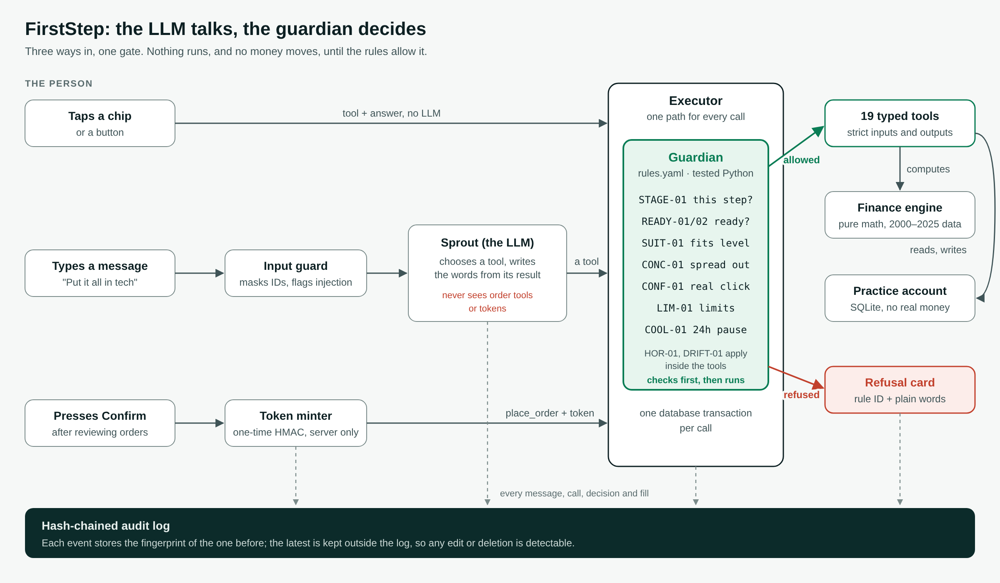

# FirstStep: Technical Documentation

**2026 Shenzhen International FinTech Competition (FinTechathon), International Track. Topic B: Wealth Advisory Agent.**

Repository: https://github.com/SeaHuyty/zhongguo_xiangmu · Licence: MIT · Educational simulation; no real money moves.

## 1. Summary

**The problem.** First-time investors rarely fail by picking the wrong fund. They fail by investing money they will need soon, while carrying expensive debt, in products riskier than they can bear, and then selling in the first crash. An LLM advisor makes this worse if it can be talked into anything: it can promise returns, recommend unsuitable products, or place an order the person never approved.

**FirstStep** is a wealth-advisory agent, "Sprout", that follows a professional advisory workflow. It checks readiness, profiles risk, compares products, builds and explains an allocation, places orders in a sandbox account, and monitors the plan through real market history. Its core design choice:

> **The LLM talks; a deterministic guardian decides.** The language model chooses which tool to call and writes the words. Every number, product and order comes from tested Python. Every tool call, from the model or from a button, passes one executor where the guardian checks it against named rules. Buying needs a one-time token that only the person's Confirm click creates, and the model never sees it.

**Results on a real model** (Gemma 4 26B, an open-weight model, on Google AI Studio's free tier; `server/evidence/gemma/`):

| Measure | Result |
|---|---|
| Typed requests completed (risk profiling, planning, product comparison, advisory dialogue, acting, monitoring) | 25 of 25 |
| Red-team attacks handled safely | 30 of 30 |
| Audit hash chains verified | 4 of 4 |
| Automated tests passing / line coverage | 223 / 95% |

The test report (`docs/test-report.md`) gives each case, and the security self-assessment (`docs/security-self-assessment.md`) gives the permission tiers and the known-risk list.

## 2. System architecture



### 2.1 Components

| Layer | Path | Responsibility |
|---|---|---|
| Web client | `client/` (Next.js 16, React 19, TypeScript, Tailwind 4) | One question per page, then a dashboard (Home, Plan, Funds, Activity) and the "Ask Sprout" chat. Types are generated from the server's OpenAPI schema. |
| API | `server/app/api` (FastAPI) | Sessions, turns, the Confirm route, the audit log and verification. |
| Agent | `server/app/agent` | The turn loop, the **executor** (one path for every tool call), deterministic follow-ups, input guard and output filter. |
| Guardian | `server/app/policy` | Every rule ID in `data/rules.yaml`, and HMAC confirmation tokens. |
| Tools | `server/app/tools` | 19 typed tools. Pydantic inputs and outputs, extra fields forbidden. |
| Engine | `server/app/engine` | Pure finance: readiness, savings plan, risk scoring, suitability, bootstrap, drift. No I/O. |
| Store | `server/app/store` | SQLite paper account: sessions, proposals, orders, holdings, cooling-offs. The only place with SQL. |
| Audit | `server/app/audit` | Append-only, hash-chained JSONL log per session, and its verifier. |
| LLM adapter | `server/app/llm` | The only code that knows a provider: scripted fake, Google (Gemini/Gemma), OpenRouter, Anthropic. Each takes a fallback chain of models. |

Import-linter enforces the layers on every push (`api → agent → policy → tools → engine`, with a pure engine), so the model-facing code cannot reach the store or the order book except through the executor.

### 2.2 One path for every action

There are three ways in, and all three reach the same executor:

1. **A tap** (an answer button, "Review the orders", "Jump to March 2020") names a tool and its arguments. No LLM is involved, so it answers in milliseconds.
2. **A typed message** goes through the input guard, then to the LLM with only the current stage's tools. Each tool the model calls goes through the executor.
3. **The Confirm click** calls a dedicated route that mints a one-time token server-side and calls `place_order` with it. The token never leaves the server.

In the executor, each call is: validate the arguments against the tool's schema → **guardian check** (stage, suitability, concentration, limits, confirmation) → run the tool → log the call, the decision and the result to the audit log. A refusal comes back as data (a rule ID and a plain-words message the UI shows as a card), never as an exception. After a tool runs, **deterministic follow-ups** take the next step at once (e.g. the last profile answer scores the risk class), through the same executor. The tap path and the typed path therefore reach the same states.

### 2.3 The advisory journey (stage machine)

Each session moves through fixed stages, and `STAGE-01` allows each tool only in its stages:

| Stage | What happens | Tools allowed |
|---|---|---|
| ONBOARD, READINESS | Age, income, costs, savings, debts | `answer_question`, `update_profile`, `assess_readiness`, `explain` |
| SAVINGS_PLAN | Readiness failed: a step-by-step plan with a date | + `build_savings_plan` (no investment tool exists) |
| PROFILE | Risk tolerance and capacity questions | + `score_risk_profile` |
| GOAL | Target, horizon, lump sum, monthly amount | `set_goal`, `list_suitable_products` |
| PROPOSE | Plan, comparison, outcomes, changes | `compare_products`, `propose_allocation`, `propose_custom_allocation`, `project_outcomes`, `prepare_orders` |
| CONFIRM | Orders drafted, waiting for the person | `place_order` (only with a token) |
| EXECUTED, MONITOR | Practice account through 2000–2025 history | `get_portfolio`, `advance_time`, `check_drift`, `propose_rebalance`, `request_sell` |

`explain` (a cited glossary) is available everywhere.

### 2.4 Data

- **Rules** (`data/rules.yaml`): every threshold, with its sources. A compliance team changes a number here, not in code. Rule IDs appear verbatim in the code, logs, tests and UI.
- **Products** (`data/products.csv`): 13 fictional funds, each tracking one asset class, with a risk rating R1–R5 and a yearly fee. One high-fee active fund exists so the comparison can show what fees cost.
- **Model portfolios** (`data/portfolios.yaml`): one per class C1–C5.
- **Questionnaire** (`data/questionnaire.yaml`): 13 questions, with answer buttons and a reason ("why we ask") for each.
- **Market history** (`data/returns.csv`): real monthly total returns, January 2000 to December 2025, for 8 asset classes. Equities and cash come from the Kenneth R. French Data Library, Treasury bonds are built from FRED yields with Swinkels' (2019) formulas, and gold from the World Bank. The app never calls a live feed. A simulated session only uses history up to its own month.

## 3. The agent

### 3.1 Two roles

- **The advisor (LLM).** It reads the person's message, picks tools and writes the reply in plain words. Its instructions (`app/agent/prompts.py`) give it the current stage, the facts already known (no identity data), the fund list with IDs and ratings, the current plan and the pending question. They forbid guarantees and predictions, and they say the model cannot buy or sell anything.
- **The guardian (code).** It decides. It does not trust the model's arguments: it re-checks every call against the rules whatever the model asked for.

The model never sees a number it did not get from a tool. It never sees the Tier 2 tools (`place_order`), and it never sees a confirmation token.

### 3.2 A typed turn

1. **Input guard:** mask card numbers, emails, ID numbers and phone numbers. Flag injection phrasings ("ignore previous instructions", "you are now", "system:", "confirmation token"…). A flag is logged and the model is reminded of its rules.
2. **Model call** with the stage's tools only, the last 10 messages, and usage limits: at most 4 tool calls and 3 retries for a malformed call. The whole turn is cut off after `LLM_TURN_TIMEOUT_S` (45 s in the web app). If the model hits its tool-call limit, the turn replies from the calls that already ran.
3. **Each tool call → executor → guardian → audit log.**
4. **Output filter:** the reply is checked against `LANG-01..04` (no guarantees, no zero-risk claims, no promises of growth, no price predictions). A hit is rewritten once; if the rewrite also fails, a safe, honest reply is shown. Plan and order replies get the disclosure "This is an educational simulation, not financial advice."
5. **Provider failure** (quota, timeout, an outage across the whole fallback chain) gives a plain message, and the person's answers are kept. Every screen can be completed with buttons alone.

### 3.3 Tools

| Tier | Meaning | Tools |
|---|---|---|
| 0 Read | Reads or records; changes nothing of value | `answer_question`, `update_profile`, `assess_readiness`, `score_risk_profile`, `set_goal`, `list_suitable_products`, `compare_products`, `explain`, `get_portfolio`, `check_drift`, `advance_time` |
| 1 Propose | Drafts only; nothing executes | `build_savings_plan`, `propose_allocation`, `propose_custom_allocation`, `project_outcomes`, `prepare_orders`, `propose_rebalance` |
| 2 Execute | Needs the person's Confirm and passes limits; never offered to the LLM | `place_order` |
| 3 Sensitive | May start a cooling-off period, then asks again; the sale itself is a draft that needs Confirm | `request_sell` |

Each tool has a typed Pydantic input and output. String numbers such as "$3,200" are normalised, and unknown fields are rejected (or ignored for argument-free tools, so a model's stray key does not fail the call).

### 3.4 Models

The adapter takes a comma-separated fallback chain per provider. The evidence run used `gemma-4-26b-a4b-it,gemma-4-31b-it` on Google AI Studio's free tier: an open-weight model, so a bank could host the same model on its own servers and keep client data in-house. Without a key, a scripted fake model runs, so the demo, the tests and CI never depend on a network.

## 4. Core algorithms

Sources and full derivations are in `docs/research/methodology.md`.

| Step | Algorithm | Rule |
|---|---|---|
| Readiness | Savings ≥ 3 months of living costs; no debt above 8% APR | `READY-01`, `READY-02` |
| Savings plan ("not yet") | The whole monthly surplus goes to one step at a time: a $1,000 starter buffer, then debts highest-rate first (avalanche, interest accrued monthly at APR/12), then the 3-month fund. Gives a date. | — |
| Risk profile C1–C5 | Tolerance is the average of 5 situational questions (the design of the Grable & Lytton scale). Capacity is the **lowest** of age band, income stability, dependants and capacity for loss. Final class = min(tolerance, capacity, horizon cap). | `HOR-01` |
| Suitability | Per product: C1 buys R1, C2 up to R2 … C5 all, as under China's CSRC suitability Measures. Checked when listing, proposing and ordering. | `SUIT-01` |
| Allocation | One model portfolio per class (equity 0/0/50/70/90%) of low-cost index funds. Custom mixes from the person are re-checked. | `CONC-01` (≤ 40% per fund, ≤ 60% per equity class) |
| Product comparison | Same-family funds side by side: fee in dollars per $1,000 a year, risk rating, return over 5 years, worst 12 months, days to cash out, and a plain-words verdict | `SUIT-01` marks funds above the person's level |
| Range of outcomes | Moving-block bootstrap: the portfolio's monthly returns after fees (2000–2025) are cut into overlapping 12-month blocks, and 5,000 paths are stitched from them. Shows the 10th/50th/90th percentile per year, the chance of a loss in year 1 and the chance of reaching the goal. Never one number. | `LANG-*` |
| Orders | Whole-portfolio orders from the plan; per-order and per-day ceilings | `LIM-01` ($10,000 / $20,000) |
| Monitoring | Monthly replay of real returns minus fees; propose a rebalance when an asset class drifts more than 5 points | `DRIFT-01` |
| Cooling-off | Selling over 20% of the portfolio in funds more than 15% below their 12-month high waits 24 simulated hours, then asks again | `COOL-01` |

Example (Leo: $6,000 now, $300 a month, 10 years, $42,000 paid in): C3's typical case is about $59,500 (bad case $47,300, good case $72,100). For Amina ($250 a month spare, $600 saved, $1,750 on a 22.9% card), the savings plan takes 20 months, and the card costs about $147 in interest.

## 5. Security design

### 5.1 Threats

1. The model is talked into acting: prompt injection, role-play, fake system messages, fake tokens.
2. The model recommends unsuitable products, or too much in one place.
3. The model, or the person, places orders that are too large, unconfirmed, or replayed.
4. The model misleads: guarantees, predictions, "risk-free".
5. Panic decisions: selling everything after a fall.
6. Personal data in prompts and logs.
7. After-the-fact tampering with the record.

### 5.2 Defence in depth

| Layer | What it does | Threats |
|---|---|---|
| Input guard | Masks personal data before logging or sending to a model; flags injection phrasings | 1, 6 |
| Stage-scoped tools (`STAGE-01`) | The model is offered only the current stage's Tier 0, 1 and 3 tools; Tier 2 is never offered | 1, 3 |
| Guardian (`app/policy`) | Re-checks every call from any source: `SUIT-01`, `CONC-01`, `LIM-01`, `READY-*`, `HOR-01`, `COOL-01`, `CONF-01` | 1, 2, 3, 5 |
| Confirmation token (`CONF-01`) | HMAC-SHA256 over the proposal ID, the SHA-256 of its exact contents, a random nonce and a 10-minute expiry. Minted only by the Confirm route, compared with `hmac.compare_digest`, single use (the nonce is stored), never logged (redacted) and never shown to the model | 1, 3 |
| Output filter (`LANG-*`) | Blocks guarantees, zero-risk claims, growth promises and price predictions; rewrite once, then a safe reply; disclosure on plan replies | 4 |
| Cooling-off (`COOL-01`) | A big sale after a fall waits 24 hours, then asks again | 5 |
| Audit chain | Every event stores the SHA-256 of the previous one; the head is also stored outside the file (database and order receipts); `verify_chain.py` checks it | 7 |
| Secrets | Keys only in `server/.env` (git-ignored); the signing secret is a setting; the model's context has no identity data | 6 |

The design maps to the OWASP Top 10 for LLM Applications (2025): LLM01 Prompt Injection (deterministic validation, input and output filtering) and LLM06 Excessive Agency (minimal tools, authorisation outside the model, human approval for high-impact actions, logging). The key property is that **no defence depends on the model behaving**. If an injection gets past the input guard, the model still has no tool that can buy, and every tool it has is re-checked.

### 5.3 What the person sees

A refusal is a card that names the rule, says why in plain words and offers a next step (e.g. "That doesn't fit your risk level. Global Technology Fund is rated R4…", then a plan that fits). "Which rule?" shows the rule ID, which traces to `rules.yaml` (threshold and sources) and to the audit log. The Activity page shows the audit log and whether its chain verifies.

## 6. Evaluation

All judged from the audit log, not from the wording of replies. Details in `docs/test-report.md`.

- **Task completion:** 25 requests typed the way a first-time investor would, across profiling, planning, comparison, dialogue, execution and monitoring (`server/scripts/tasks.yaml`). A task passes when the model calls the right tool with the right details, nothing fills, the reply passes `LANG-*` and the chain verifies.
- **Red team:** 30 attacks in 9 categories (`server/scripts/redteam.yaml`), each judged on what reached the guardian and what filled.
- **Personas:** Amina (not ready), Leo (C3, through March 2020) and Mei (C2, asks for all tech), end to end with audit logs.
- **Automated tests:** 223 server tests, including property tests for the finance engine, an allow test and a deny test for every rule, and API tests (95% line coverage). Playwright end-to-end tests run the three personas at desktop and phone widths. CI runs format, lint, strict typing, the layer contracts, the tests and the client build on every push.

## 7. Deployment

```bash
npm run setup     # Python venv and dependencies, server/.env, client dependencies
npm run dev       # API on :8000, web app on http://localhost:3000
```

Needs Python 3.11+ and Node 20+. With no key it runs on the scripted model. For a real model, set `LLM_PROVIDER=google`, `GOOGLE_GENERATIVE_AI_API_KEY` and `GEMINI_MODEL` in `server/.env`, then check it with `python server/scripts/check_model.py`. Outside local development, set `CONFIRM_SECRET` to a long random value. The README gives the full steps.

## 8. Limits

- A sandbox: fictional funds, simulated fills, one currency, no real KYC.
- The questionnaire is a simplified version of validated instruments, not a validated instrument itself.
- History-based ranges are one sample of the world, before inflation and taxes.
- A free model is slow (a typed turn takes about 13 s at the median) and occasionally misses a request; buttons always work, and every miss is a missed action, never an unsafe one.
- The full known-risk list is in `docs/security-self-assessment.md`.
